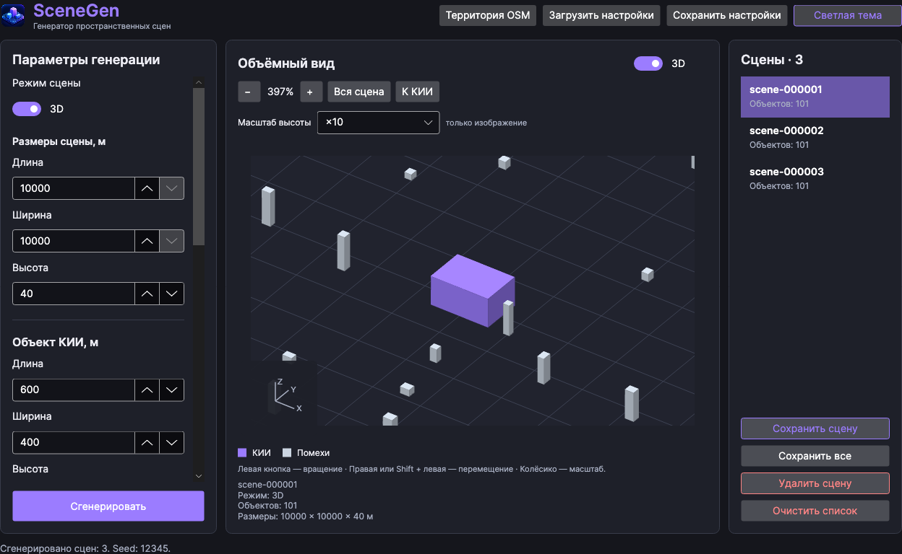
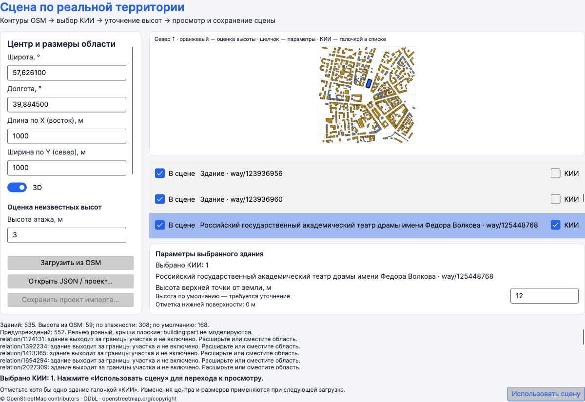

# SceneGen

[](https://github.com/balbysevs/GenerationSceneKii/actions/workflows/ci.yml)

**Генератор пространственных сцен для задачи размещения радаров.** SceneGen создаёт синтетические сцены или импортирует контуры зданий из OpenStreetMap, позволяет просмотреть их в 2D и 3D и экспортирует геометрию в JSON. Позиции радаров рассчитывает отдельный решатель. SceneGen — командный учебный проект.

## Возможности

- Генерация серии сцен с объектом КИИ и помехами по заданным размерам и расстояниям. Параметры можно задать в окне или загрузить из JSON. Одинаковые настройки и `seed` позволяют повторить генерацию.
- Импорт застройки OpenStreetMap по координатам центра и размерам участка. Одно или несколько зданий можно отметить как КИИ, уточнить их высоты и исключить лишние объекты.
- Просмотр сверху и в 3D: масштабирование, перемещение, вращение, фокус на КИИ и сведения об объектах при наведении. Есть светлая и тёмная темы.
- Сохранение выбранной сцены или всей серии. Для пакетной генерации доступно консольное приложение.

## Запуск готовой сборки

**[Скачать SceneGen для Windows и macOS](https://github.com/balbysevs/GenerationSceneKii/releases/latest)**. В разделе Assets выберите архив для своей системы.

Если вы собираете проект самостоятельно, готовые файлы появятся в следующих папках:

| Платформа | Файл | Как открыть |
| --- | --- | --- |
| macOS, Apple Silicon | `artifacts/macos/osx-arm64/SceneGen.app` | Дважды щёлкните по приложению в Finder. |
| Windows x64, Intel / AMD | `artifacts/windows/SceneGen-win-x64.zip` | Извлеките архив целиком и запустите `SceneGen.exe` из папки `SceneGen`. |

.NET включён в обе сборки. Rider и Visual Studio для запуска не нужны. На Windows оставьте библиотеки рядом с `.exe`. Папка `artifacts/` не хранится в Git: если готового файла нет, соберите его по инструкции ниже.

## Скриншоты

**Сгенерированная 3D-сцена.** Фиолетовым выделен объект КИИ, серым — помехи.



**Импорт OpenStreetMap.** Участок в центре Ярославля; театр Волкова отмечен как КИИ.



## Быстрый старт

**Случайная сцена.** Выберите режим 2D или 3D, задайте размеры участка, КИИ (объекта критической информационной инфраструктуры) и помех. Нажмите **«Сгенерировать»**. Выберите результат в списке и нажмите **«Сохранить сцену»** или **«Сохранить все»**.

**Реальная территория.** Откройте **«Территория OSM»**, введите широту и долготу центра, размеры участка в метрах и нажмите **«Загрузить из OSM»**. Отметьте нужные здания галочками **«КИИ»** и нажмите **«Использовать сцену»**. Высоты могут быть оценочными; рельеф в текущей модели плоский. [Подробнее об импорте](docs/openstreetmap-import.md).

**Демонстрация без интернета.** В окне OSM нажмите **«Открыть JSON / проект…»** и выберите [демонстрационный проект](docs/examples/territory-demo.osm-project.json). Это синтетическая сцена для знакомства с импортом.

## Запуск из исходников

Для разработки нужен **.NET 10 SDK**. Откройте `GenerationSceneKii.sln` в Rider или Visual Studio, либо выполните из корня репозитория:

```sh
dotnet build GenerationSceneKii.sln
dotnet run --project SceneGenerator.Desktop
```

Для генерации через консоль используйте [пример настроек](SceneGenerator.Console/settings.json) или укажите свой JSON:

```sh
dotnet run --project SceneGenerator.Console -- SceneGenerator.Console/settings.json
```

Консоль сохраняет по одному JSON на сцену в новую папку `Result/run-…/`.

Для упаковки готовых сборок на Mac:

```sh
./scripts/package-macos.sh
./scripts/package-windows.sh
```

Подробные инструкции: [сборка macOS](docs/macos-app.md) · [сборка Windows](docs/windows-app.md).

## Структура проекта

| Проект | Назначение |
| --- | --- |
| [`SceneGenerator.Core`](SceneGenerator.Core/) | Модели сцен, геометрия, проверка параметров и генерация. |
| [`SceneGenerator.OpenStreetMap`](SceneGenerator.OpenStreetMap/) | Загрузка данных OSM, обработка контуров и преобразование координат. |
| [`SceneGenerator.Serialization`](SceneGenerator.Serialization/) | Чтение настроек и экспорт сцен в JSON. |
| [`SceneGenerator.Desktop`](SceneGenerator.Desktop/) | Оконное приложение на Avalonia и просмотр сцен. |
| [`SceneGenerator.Console`](SceneGenerator.Console/) | Генерация и сохранение сцен из терминала. |

Оконное и консольное приложения используют общие модели и генератор. Случайная генерация и импорт OSM предоставляют сцены через интерфейс [`ISceneSource`](SceneGenerator.Core/Contracts/ISceneSource.cs).

## JSON для решателя

В файле сцены передаются границы участка, геометрия объектов и допустимые зоны размещения радаров. Координаты локальные, в метрах. Объекты КИИ записываются в начале массива `objects` с типом `kii`, затем идут помехи. Для сцены с одним КИИ используется `schemaVersion: "1.0"`, с несколькими — `"1.1"`. [Правила для нескольких КИИ](docs/openstreetmap-import.md#расширение-json-для-команды-решателя).

## Проверки

При пуше в `main` и открытии или обновлении pull request GitHub Actions собирает решение и запускает проверки импорта, экспорта и логики окна. Эти проверки работают без графической сессии и публичного сервера Overpass. [Как запустить проверки локально](tests/README.md).

Дополнительно: [управление 3D-видом](docs/3d-view.md).

Данные карты: [© OpenStreetMap contributors](https://www.openstreetmap.org/copyright).
